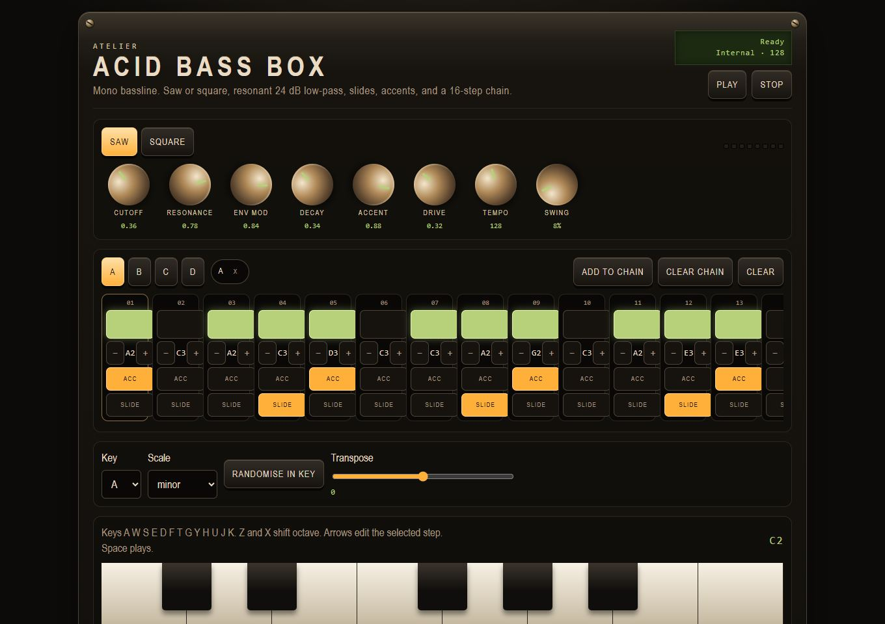

# Acid Bass Box

## Controls

Build patterns A–D on the 16-step sequencer, then arrange them in the chain. Set pitch, octave, accent and slide per step. Shape the sound with the waveform, filter, envelope and drive. Export WAV, MIDI or a JSON preset.

## Keyboard and MIDI

`A W S E D F T G Y H U J K` play a chromatic octave. `Z` and `X` shift octave. `Space` starts or stops the sequencer. MIDI note on/off plays the voice. Choose a MIDI output and use the clock source controls to send internal clock or follow external clock.
