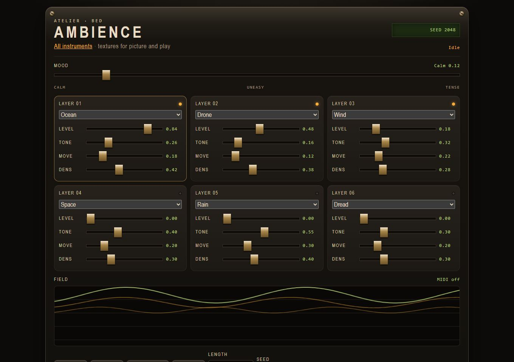

# Ambience

## Controls

Layer up to six textures. Set mood, loop length and seed, then adjust each layer’s level, tone, movement and density. Play and WAV export use the same seamless loop.

## Keyboard and MIDI

`Space` plays or stops, `1`–`6` select a layer and `[` or `]` change mood. Enable MIDI for CC 1 (mood) and CC 7, 74, 71 and 12 (selected layer level, tone, movement and density).
