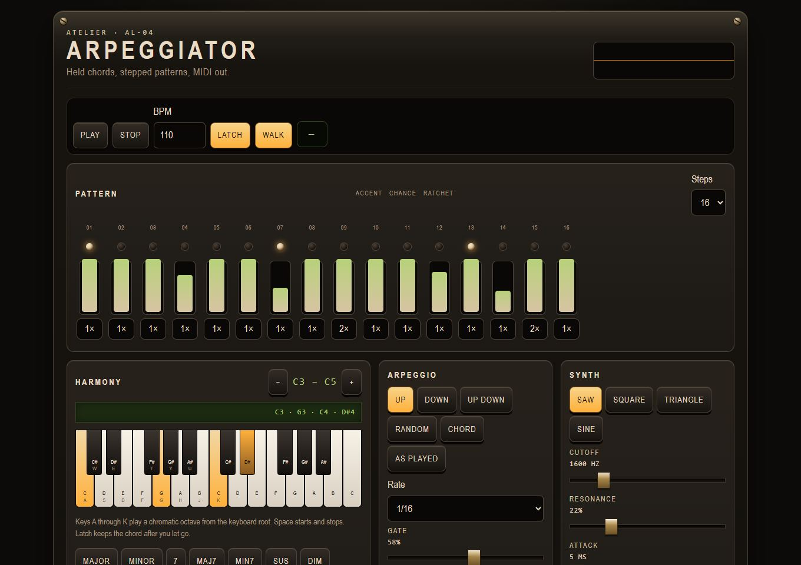

# Arpeggiator Lab

## Controls

Hold a chord, choose an order and division, then shape the pattern with gate, swing, octave range, probability, ratchets and accents. Hear the built-in synth or choose MIDI output. Export WAV or MIDI.

## Keyboard and MIDI

`A W S E D F T G Y H U J K` play a chromatic octave. `Space` starts or stops and Latch keeps the held chord. MIDI In accepts incoming notes. Choose a MIDI output and channel to send generated notes, or use the same-origin note bus with another compatible Atelier app.
