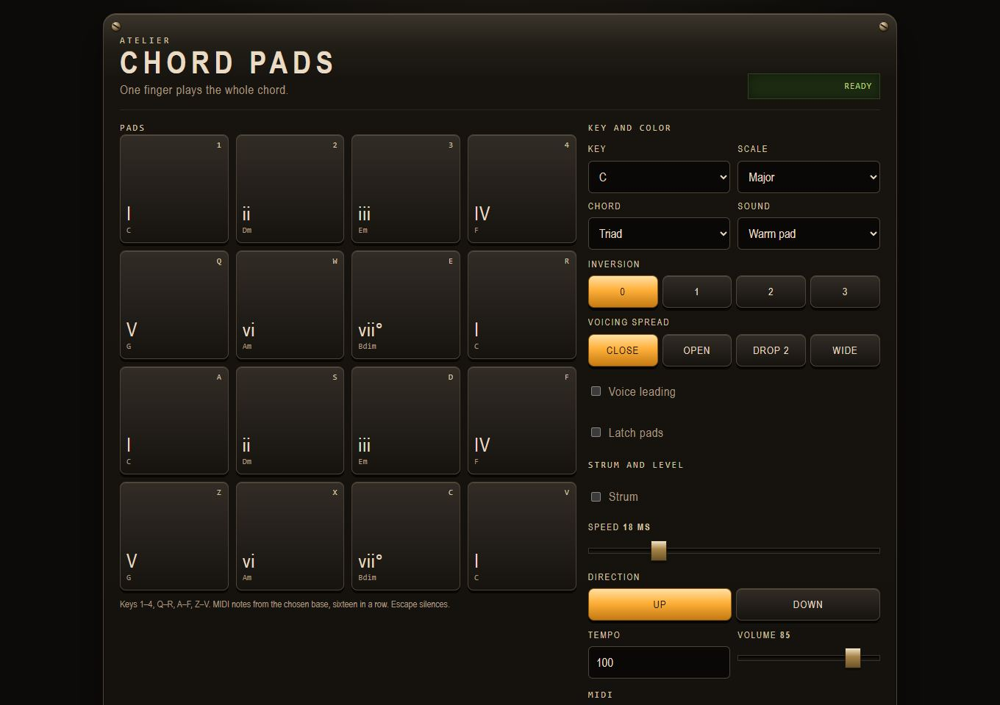

# Chord Pad Player

## Controls

Choose key, scale, chord type, voicing and sound, then play one of the sixteen pads. Turn on strum or latch, record a progression and export JSON, WAV or MIDI.

## Keyboard and MIDI

`1 2 3 4`, `Q W E R`, `A S D F` and `Z X C V` play the pads. `Escape` silences them. Enable MIDI to play sixteen consecutive notes from the selected base or choose a MIDI output to send the voiced chords.
