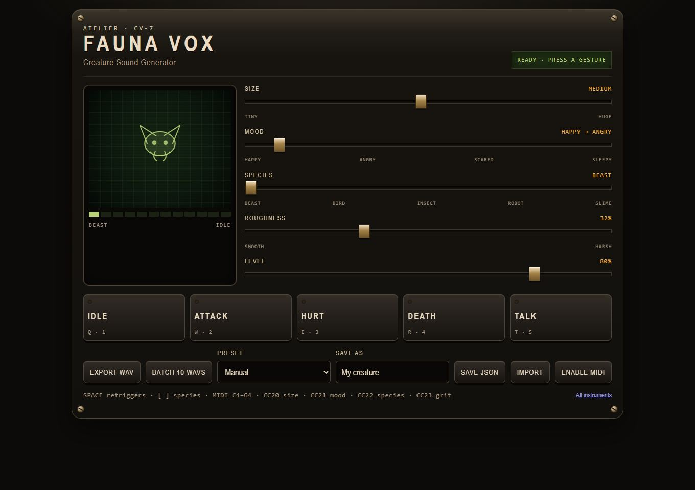

# Creature Sound Generator

## Controls

Use the Size, Mood, Species and Roughness controls to set the voice. Play Idle, Attack, Hurt, Death or Talk for a new variation. Export one WAV or a ZIP of ten variations.

## Keyboard and MIDI

`Q W E R T` or `1 2 3 4 5` play the gestures in order. `Space` retriggers the last gesture. MIDI notes 48–52 or 60–64 play the five gestures. CC 20–23 control size, mood, species and roughness. CC 1 also controls roughness and CC 7 sets level.
