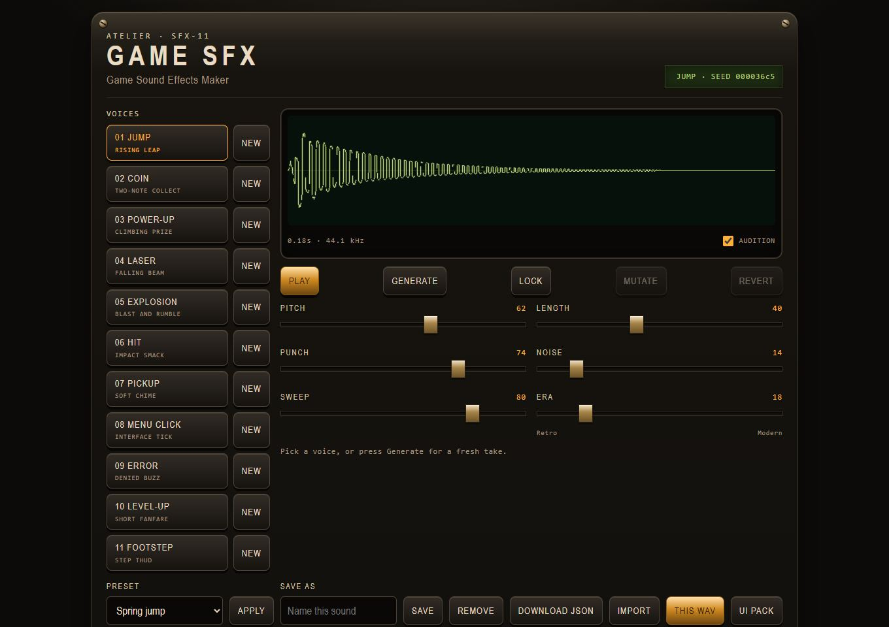

# Game Sound Effects Maker

## Controls

Select a sound category and set pitch, length, punch, noise, sweep and era. Generate a fresh take, lock it, mutate it or revert. Export a single WAV or one of the curated ZIP packs.

## Keyboard and MIDI

`1`–`9` and `0` select the first ten categories. `Space` plays, `G` generates, `L` locks and `M` mutates. The first pointer interaction arms MIDI. MIDI notes audition the active category at pitches relative to note 60. CC 1, 71, 72, 73 and 74 change sweep, noise, length, punch and era.
