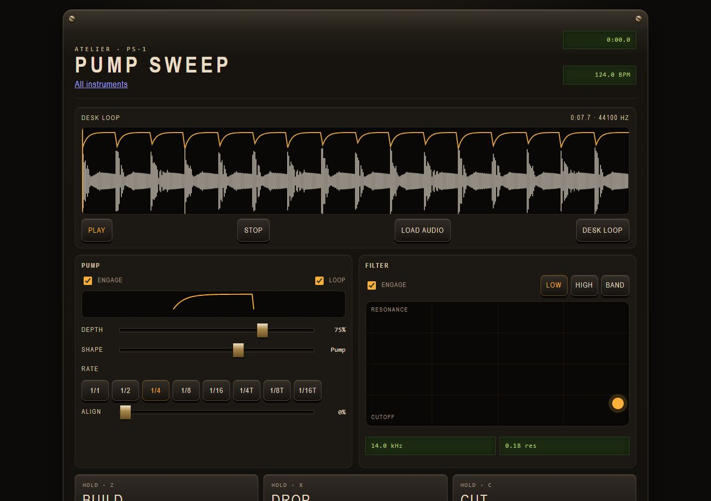

# Pump Sweep

## Controls

Play the built-in demo loop or load audio. Set tempo, pump depth, curve, rate and alignment. Use the filter pad for cutoff and resonance. Export a WAV with the moves you played during playback.

## Keyboard and MIDI

`Space` toggles playback. Hold `Z`, `X` and `C` for Build, Drop and Cut. MIDI notes 48, 50 and 52 hold those same moves. CC 74 or 1 changes cutoff and CC 71 sets resonance. Arrow keys nudge the focused filter pad.
