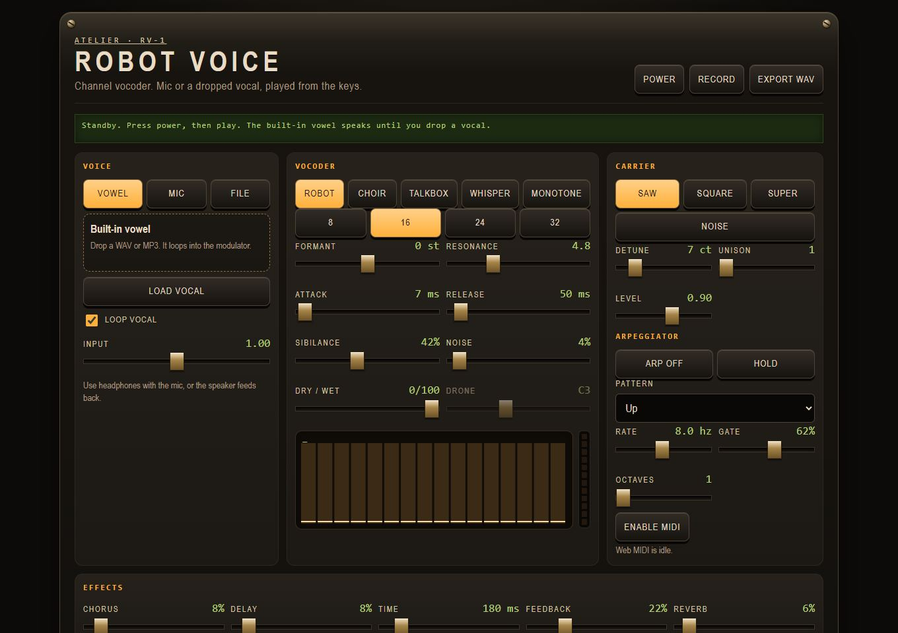

# Robot Voice Vocoder

## Controls

Turn on Power, then play the carrier. Start with the built-in vowel, select a live microphone or load a WAV or MP3. Set voice mode, bands, formant, envelopes and dry/wet mix. Record or export the output.

## Keyboard and MIDI

The lower keyboard row starts with `Z S X D C V G B H N J M`. The upper row starts with `Q 2 W 3 E R 5 T 6 Y 7 U`. On-screen controls shift octave. Enable MIDI to play the carrier with incoming note on/off and velocity.
