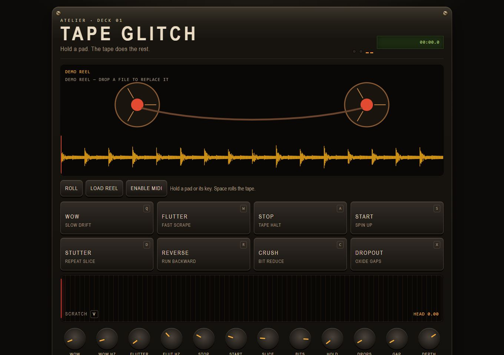

# Tape Glitch

## Controls

Start the demo reel or load audio. Hold effect pads while the tape moves and scrub the scratch strip. Export the performance as WAV. Presets use JSON.

## Keyboard and MIDI

`Q W A S D R C X` hold Wow, Flutter, Stop, Start, Stutter, Reverse, Crush and Dropout. `V` plus the arrow keys scratches, `Space` toggles transport, `Z` randomises and `Escape` releases the holds. MIDI notes 36–43 map to the pads. Hold note 48 and move pitch bend or CC 1 to scratch. CC 16–27 and 7 set trims.
