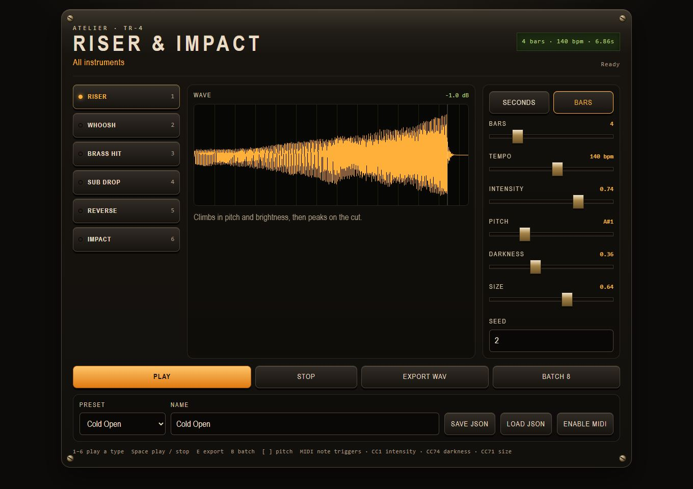

# Trailer Riser & Impact

## Controls

Choose a sound type and shape the envelope, motion, timbre and output. Set the length in seconds or bars, then audition and export a WAV. The batch control renders preset variations.

## Keyboard and MIDI

`1`–`6` audition the sound types, `Space` toggles playback, `E` exports and `B` runs the batch. `[` and `]` nudge pitch. MIDI notes trigger the selected sound and pitch bend changes the trigger pitch. CC 1 adjusts intensity, CC 74 darkness and CC 71 size.
