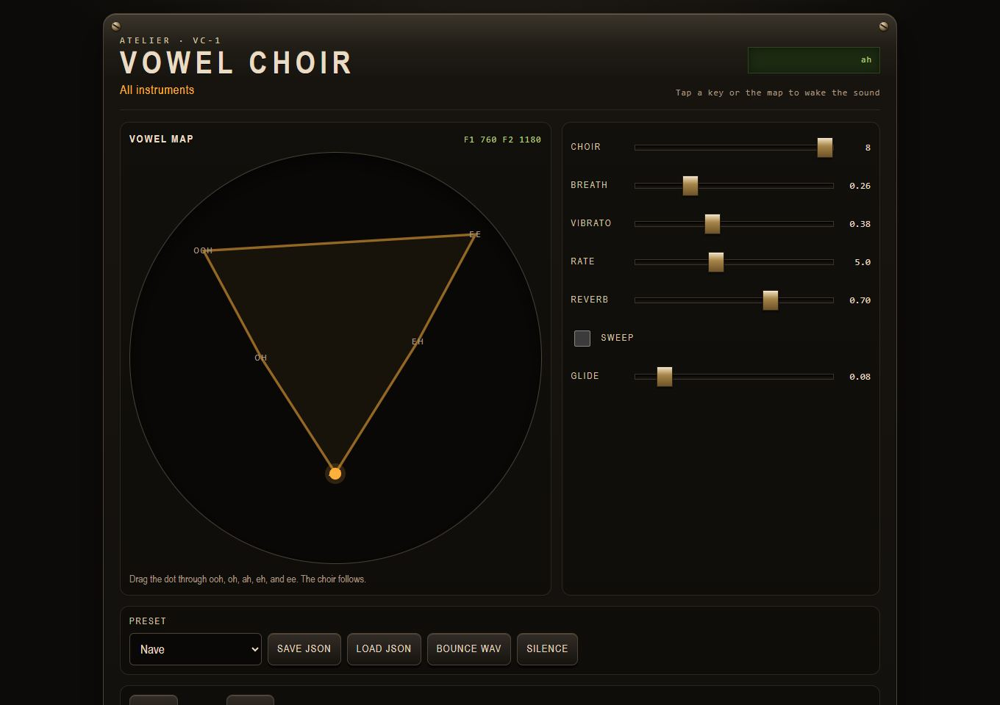

# Vowel Choir Pad

## Controls

Drag across the vowel chart while holding notes or a chord. Adjust choir size, breath, vibrato and reverb, or enable sweep for vowel motion. Save a preset or export a WAV.

## Keyboard and MIDI

`A W S E D F T G Y H U J K O L P ;` play chromatically. You can also click the on-screen keys. Arrows nudge the focused vowel chart. Use the octave buttons to move the keyboard range. Enable MIDI to hold multiple notes and play with velocity.
